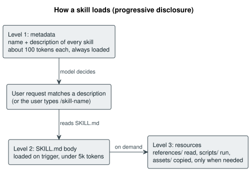
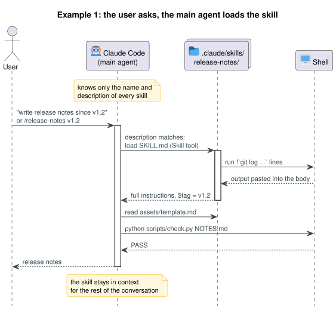
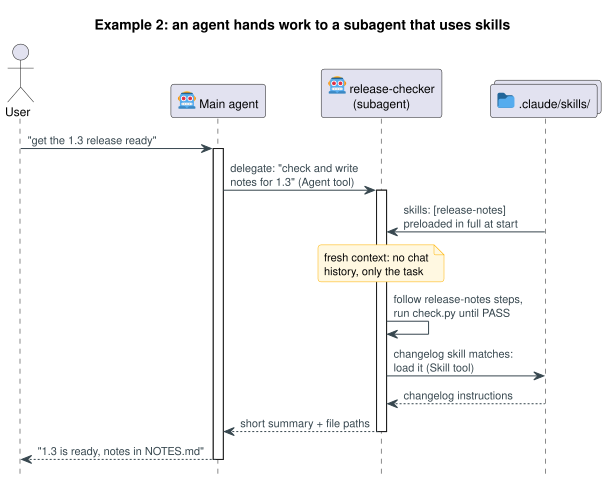
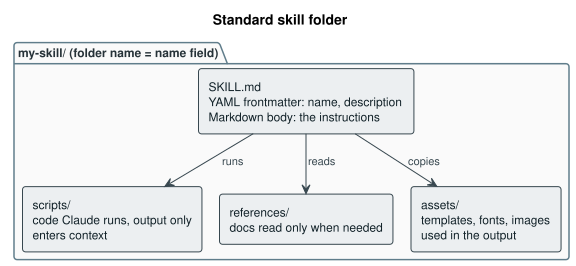

# Agent Skills

<!-- readme: ignore-acronyms CLAUDE SKILL PASS FAIL -->

This repository is an overview of agent skills: what they are, how they load, the standard folder layout, every option a `SKILL.md` can set, best practices, the top five pros and cons, and ranked links to the official documentation, with block diagrams throughout.

Every fact below was checked against the linked documentation on 3 November 2026, and every command shown was run.

---

<!-- toc -->

* [1 What a skill is](#1-what-a-skill-is)
  * [1.1 Pros and cons](#11-pros-and-cons)
  * [1.2 Where skills live](#12-where-skills-live)
  * [1.3 Skills compared with neighbours](#13-skills-compared-with-neighbours)
* [2 Workflows](#2-workflows)
  * [2.1 Example 1: prompted by the user](#21-example-1-prompted-by-the-user)
  * [2.2 Example 2: used by an agent](#22-example-2-used-by-an-agent)
* [3 Standard layout](#3-standard-layout)
  * [3.1 The SKILL.md file](#31-the-skillmd-file)
  * [3.2 Three common shapes](#32-three-common-shapes)
  * [3.3 Skeleton to copy](#33-skeleton-to-copy)
* [4 Auditing a skill collection](#4-auditing-a-skill-collection)
* [5 Documentation, ranked](#5-documentation-ranked)
  * [5.1 Anthropic](#51-anthropic)
  * [5.2 Open standard and other tools](#52-open-standard-and-other-tools)
  * [5.3 Commentary](#53-commentary)
* [6 Terminology](#6-terminology)
* [7 References](#7-references)

<!-- /toc -->

---

## 1 What a skill is

A skill is a folder holding a `SKILL.md` file of instructions, plus optional scripts, reference documents and assets, that teaches an agent such as Claude Code how to do one kind of task the way you want it done. Anthropic published the format as an open standard in December 2025, so the same folder also works in other agents such as OpenAI Codex.

The key idea is progressive disclosure: the agent always sees only the short name and description of each skill, and reads the rest only when a request matches. The diagram shows the three levels.

<p align="center"></p>

### 1.1 Pros and cons

The two lists below are the short case for and against skills.

#### 1.1.1 Top five pros

These are ranked by how much difference they make in practice.

1. **Almost free until used.** Each skill costs about 100 tokens of context while idle, so twenty skills cost less than one long chat message. The full instructions load only on a match.
2. **Your rules applied every time.** House style, such as a heading scheme or banned words, is written once and followed in every session without repeating it.
3. **Scripts make results checkable.** A skill can ship code, such as a linter or a diagram renderer, so the agent runs a test instead of trusting itself. Only the script output enters the context, not the script.
4. **Portable open standard.** The same folder works in Claude Code, the Claude apps, the API (Application Programming Interface), Codex and roughly twenty other agents listed on skills.sh.
5. **Plain files.** A skill is a folder of text, so it can be versioned in git, reviewed, copied to another machine or shipped in a plugin.

#### 1.1.2 Top five cons

These are ranked by how likely each is to cause a real problem.

1. **Triggering is a guess.** The model decides from the description alone, so a vague description never fires and a broad one fires on the wrong request. Long descriptions get cut, and the whole listing is capped near 1% of the context window in Claude Code.
2. **Security.** A skill can run scripts with your permissions and fetch from the network. Anthropic says to install skills only from trusted sources and to read every bundled file first.
3. **Drift and overlap.** As a collection grows, skills duplicate each other and fall out of date. Nothing warns you unless you run an audit like the one in section 4.
4. **Platform differences.** The core format is shared, but folders and extras are not: Codex reads `.agents/skills`, and Claude Code fields such as `disable-model-invocation` mean nothing elsewhere. The API also needs code execution turned on.
5. **Hard to test.** Whether a skill fires and helps can only be measured by running prompts against it, which is why Anthropic ships the `skill-creator` skill with an evaluation loop.

### 1.2 Where skills live

Claude Code finds skills in these places, listed from most to least specific. Codex reads the same format from `.agents/skills` instead.

1. **Project:** `.claude/skills/<skill-name>/SKILL.md`, shared with everyone who clones the repository.
2. **Personal:** `~/.claude/skills/<skill-name>/SKILL.md`, available in every project.
3. **Plugin:** `<plugin>/skills/<skill-name>/SKILL.md`, installed from a marketplace such as `anthropics/skills`.
4. **Enterprise:** pushed by managed settings in an organisation.

### 1.3 Skills compared with neighbours

A skill is not the only way to give Claude standing knowledge. The ranking is by how often each is the right choice for reusable know how.

1. **Skill**, recommended for a repeatable task with its own rules or tools, because it costs almost nothing until it is used.
2. **CLAUDE.md (project memory file)**, for a handful of rules that apply to every single request; it is always loaded, so it must stay short.
3. **MCP (Model Context Protocol) server**, when Claude needs live access to an outside system such as a calendar or database rather than instructions.
4. **Subagent**, when a task needs its own separate context window rather than extra instructions in the main one.

## 2 Workflows

A skill is used in one of two ways: a person asks and the main agent loads the skill, or an agent hands a task to a subagent that already has the skill. Both examples use the `release-notes` skill shown in section 3.1.

The ranking below says which to reach for first.

1. **Prompted by the user**, recommended as the default, because you see and steer every step and the skill is found automatically.
2. **Used by an agent**, when the job is long, repeated, or would fill the main conversation with files and logs.

### 2.1 Example 1: prompted by the user

The user works in the main conversation. Claude Code holds only the name and description of each skill until a request matches one.

<p align="center"></p>

1. **The request arrives.** Plain text such as "write release notes since v1.2" lets Claude choose the skill from its description; typing `/release-notes v1.2` at the start of the message runs it directly.
2. **The skill loads.** Claude calls the Skill tool, the ``!`command` `` lines run first, and their output plus the `SKILL.md` body enter the conversation with `$tag` set to `v1.2`.
3. **Claude follows the steps,** reading `assets/template.md` only when the body says to and running `scripts/check.py` until it prints PASS.
4. **The skill stays loaded** for the rest of the conversation, so every line of the body is a recurring token cost.

### 2.2 Example 2: used by an agent

Here the main agent delegates. A subagent defined in `.claude/agents/release-checker.md` lists the skill in its `skills` field, so the skill is part of the subagent from the start.

```markdown
---
name: release-checker
description: Prepares a release by checking the build and writing release notes.
tools: Read, Grep, Bash, Skill
skills:
  - release-notes
---

You prepare releases. Follow the release-notes skill exactly, then reply with
a short summary and the paths of the files you wrote.
```

The diagram shows what happens when the user asks the main agent for the whole release.

<p align="center"></p>

1. **The user asks the main agent** for a bigger job, such as "get the 1.3 release ready".
2. **The main agent delegates** with the Agent tool, passing only a task description.
3. **The subagent starts fresh,** with no conversation history, but with the full text of every skill in its `skills` list already loaded rather than just the descriptions.
4. **It can load more skills** through the Skill tool when another description matches, unless `Skill` is left out of its `tools`.
5. **Only a summary comes back,** so the main conversation stays short however much the subagent read.

Two limits apply. A skill with `disable-model-invocation: true` cannot be preloaded, and the related `context: fork` field works the other way round, running a skill inside a subagent the skill names. Both are covered in [preloading skills into subagents](https://code.claude.com/docs/en/sub-agents#preload-skills-into-subagents) and [running skills in a subagent](https://code.claude.com/docs/en/skills#run-skills-in-a-subagent).

## 3 Standard layout

The open standard fixes one required file and three optional folders. The folder name must match the `name` field.

<p align="center"></p>

### 3.1 The SKILL.md file

`SKILL.md` starts with YAML (YAML Ain't Markup Language) frontmatter between two `---` lines, then a Markdown body. The example below sets every field the open standard and Claude Code accept, with a comment on each, for a skill that writes release notes. A real skill uses only a few of them.

```markdown
---
# Open standard fields: every tool that supports skills reads these
name: release-notes                 # REQUIRED: 1 to 64 chars, a to z, 0 to 9, hyphens;
                                    # must match the folder name
description: Write release notes from the git log since the last tag. Use
  whenever the user asks for release notes, a changelog entry or "what changed
  since", even if they never say "release notes".
                                    # REQUIRED: up to 1,024 chars, what and when
license: Apache-2.0                 # licence name, or point to a bundled LICENSE.txt
compatibility: git, Python 3.10+    # needs, up to 500 chars
metadata:                           # your own key value pairs; tools ignore them
  author: example-team
  version: "1.0"
allowed-tools: Bash(git *) Read     # tools usable without asking (experimental)

# Claude Code fields: other tools ignore these
when_to_use: "summarise the sprint" # extra trigger text
argument-hint: "[tag]"              # shown in the / menu while typing
arguments: [tag]                    # names the first argument $tag in the body
disable-model-invocation: false     # true: runs only when typed as /release-notes
user-invocable: true                # false: hidden from the / menu, Claude only
disallowed-tools: AskUserQuestion   # tools removed while the skill runs
model: inherit                      # model for this turn; inherit keeps the current
effort: medium                      # low, medium, high, xhigh or max for this turn
context: fork                       # fork: run the skill in a separate subagent
agent: general-purpose              # which subagent type, only with context: fork
background: true                    # false: wait for the forked subagent's result
paths: "CHANGELOG.md, docs/**"      # load automatically only near matching files
shell: bash                         # bash or powershell for the ! commands below
hooks: {}                           # hooks registered while the skill is active
---

# Release notes

Compare from tag $tag. All arguments: $ARGUMENTS. First argument: $0.

## Context gathered before Claude reads this file
Last tag: !`git describe --tags --abbrev=0`
Recent commits: !`git log --oneline -20`

## Steps
1. Fill in [the template](assets/template.md).
2. Read [the house rules](references/rules.md) only when unsure of a rule.
3. Run `python ${CLAUDE_SKILL_DIR}/scripts/check.py NOTES.md` until it prints PASS.
```

Most skills need only the first two fields. The others are ranked by how often they earn their place.

1. **name and description**, always. The description is the only text the model sees before choosing a skill, so put the main use first and list the phrases a user would say.
2. **`disable-model-invocation`**, for anything with side effects such as deploying or sending messages, so it runs only when you type the slash command.
3. **`allowed-tools`**, to stop permission prompts for the few commands the skill always runs.
4. **context and agent**, for long research or checking jobs that would otherwise fill the main conversation.
5. **`arguments` and `argument-hint`**, when the skill takes input such as a tag, a file or an issue number.
6. **paths**, to tie a skill to one part of a repository, such as only the firmware folder.
7. **The rest** (license, compatibility, metadata, model, effort, shell, hooks) only when publishing the skill or tuning one specific case.

The body can also use three Claude Code features, all shown above.

1. **Substitutions:** `$ARGUMENTS`, `$0`, `$1` and named arguments such as `$tag` are replaced with what the user typed; `${CLAUDE_SKILL_DIR}` is the skill's own folder, so scripts are found from any working directory.
2. **Command injection:** a line containing ``!`command` `` runs the command first and pastes its output in, so Claude starts with live data. Only use it in skills you trust.
3. **Relative links:** links to `references/` and `assets/` files are read only when Claude follows them, which keeps the body short.

The full field tables are in the [Claude Code frontmatter reference](https://code.claude.com/docs/en/skills#frontmatter-reference) and the [specification](https://agentskills.io/specification#frontmatter).

### 3.2 Three common shapes

Most skills fall into one of three shapes. The table says what each holds and what it suits.

| Shape | What the folder holds | Suits |
|---|---|---|
| Instructions only | just `SKILL.md` | writing, tone, checklists |
| Rules plus a checker | `SKILL.md`, a `scripts/` checker, an `assets/` template | house style documents |
| Full toolchain | all folders, plus a runtime the scripts build | rendering, conversion, hardware tools |

The ranking of shapes, for a new skill, is as follows.

1. **Rules plus a checker**, recommended, because a script that returns PASS or FAIL turns soft instructions into something the agent can prove.
2. **Instructions only**, for judgement tasks such as writing a message, where no script can check the answer.
3. **Full toolchain**, only when the task truly needs its own runtime, because it is the most work to keep running on every platform.

### 3.3 Skeleton to copy

This is a complete skill folder with every file empty. Only `SKILL.md` is required; delete any folder the skill does not need. Contents are indented under their folder, and the text on the right says what each item is for. Each name links to the section of the official documentation on how best to use it.

<pre>
<a href="https://agentskills.io/specification#directory-structure">my-skill/</a>                  the skill; folder name must equal the name field
├── <a href="https://platform.claude.com/docs/en/agents-and-tools/agent-skills/best-practices#skill-structure">SKILL.md</a>               required: frontmatter, then the instructions
├── <a href="https://agentskills.io/specification#license-field">LICENSE.txt</a>            optional terms, needed only if you share the skill
├── <a href="https://platform.claude.com/docs/en/agents-and-tools/agent-skills/best-practices#provide-utility-scripts">scripts/</a>               code the agent runs; only its output costs tokens
│   ├── <a href="https://platform.claude.com/docs/en/agents-and-tools/agent-skills/best-practices#implement-feedback-loops">check.py</a>           checker that prints PASS or FAIL on the output
│   └── <a href="https://platform.claude.com/docs/en/agents-and-tools/agent-skills/best-practices#package-dependencies">requirements.txt</a>   pinned packages for a venv built outside the skill
├── <a href="https://platform.claude.com/docs/en/agents-and-tools/agent-skills/best-practices#progressive-disclosure-patterns">references/</a>            long docs, read only when SKILL.md points here
│   └── <a href="https://platform.claude.com/docs/en/agents-and-tools/agent-skills/best-practices#structure-longer-reference-files-with-table-of-contents">rules.md</a>           detailed rules, worked examples, edge cases
├── <a href="https://agentskills.io/specification#optional-directories">assets/</a>                files used in the output, never read as orders
│   └── <a href="https://platform.claude.com/docs/en/agents-and-tools/agent-skills/best-practices#template-pattern">template.md</a>        starting file the agent copies and fills in
└── <a href="https://code.claude.com/docs/en/skills#run-evals-with-skill-creator">evals/</a>                 test prompts for the skill-creator skill
    └── <a href="https://github.com/anthropics/skills/blob/main/skills/skill-creator/references/schemas.md">evals.json</a>         prompts plus what a good answer must contain
</pre>

This command creates the skeleton above. It was run in Git Bash and produced exactly that tree.

```bash
mkdir -p my-skill/{scripts,references,assets,evals}
touch my-skill/{SKILL.md,LICENSE.txt} my-skill/scripts/{check.py,requirements.txt}
touch my-skill/references/rules.md my-skill/assets/template.md my-skill/evals/evals.json
```

Each part could be used like this, ranked by how much value it adds to a new skill.

1. **`SKILL.md`:** write a description that says what the skill does and when to use it, then a body of steps that ends with "run `scripts/check.py`, and do not stop until it passes".
2. **`scripts/check.py`:** check the agent's output against your rules, for example heading numbering, banned words or broken links. A script is the only part that gives a hard yes or no.
3. **`references/rules.md`:** move detail here when `SKILL.md` nears 500 lines, and link to it from the body with one line saying when to read it.
4. **`assets/template.md`:** give the agent a starting file that already passes the checker, so every output starts in the right shape.
5. **`evals/evals.json`:** list five to ten realistic prompts, then let `skill-creator` run them with and without the skill to show whether it triggers and helps.
6. **`scripts/requirements.txt`:** pin the packages, and have the script build its venv under `~/.cache`, never inside the skill folder (see section 4).
7. **`LICENSE.txt`:** add only when you publish the skill to a marketplace or a public repository.

## 4 Auditing a skill collection

A collection drifts as it grows, so check it now and then. These are the problems worth looking for, ranked by how much they affect day to day use.

1. **Description over 1,024 characters.** The specification forbids it, Claude Code cuts the listing at 1,536 characters, and other tools may reject the skill outright.
2. **Name breaks the rules or differs from the folder.** Only lowercase letters, digits and single hyphens are allowed, so an underscore is enough to fail.
3. **A runtime inside the skill.** A `.venv` or `node_modules` folder adds thousands of files. Build it under `~/.cache` instead so the skill stays small.
4. **`SKILL.md` over 500 lines.** Move detail into `references/`.
5. **Overlapping triggers.** When two skills both match a request, add a line to each description saying when to prefer the other.

The tool in this repository checks the first four automatically. It needs only the Python standard library and reads your personal skills in `~/.claude/skills` unless you pass another folder; the second line audits a project's skills instead.

```bash
python tools/audit_skills.py
python tools/audit_skills.py .claude/skills -o local/project-audit.md
```

It prints a one line summary and writes a Markdown table with each skill's description length, line count, file count and problems. The report goes to `local/`, which is listed in `.gitignore`, so a personal audit never reaches the public repository.

## 5 Documentation, ranked

Every link below returned HTTP (Hypertext Transfer Protocol) 200 when this page was written. Start at the top; each item says why it earns its place.

### 5.1 Anthropic

1. **Claude Code skills guide**, the best start for Claude Code users, because it covers skill folders, slash commands and the Claude Code only fields: https://code.claude.com/docs/en/skills
2. **Skill authoring best practices**, the rules for good descriptions, the 500 line limit and naming: https://platform.claude.com/docs/en/agents-and-tools/agent-skills/best-practices
3. **Agent Skills overview**, the three loading levels with token numbers and the field limits: https://platform.claude.com/docs/en/agents-and-tools/agent-skills/overview
4. **Engineering blog post**, the design reasoning behind progressive disclosure: https://www.anthropic.com/engineering/equipping-agents-for-the-real-world-with-agent-skills
5. **Example skills repository**, real skills to copy, including the document skills and `skill-creator`: https://github.com/anthropics/skills
6. **Using skills with the API**, only if you call Claude from code: https://platform.claude.com/docs/en/api/skills-guide
7. **Help centre article**, the plain language version for the Claude apps: https://support.claude.com/en/articles/12512176-what-are-skills
8. **Launch announcement**, history and the open standard update: https://claude.com/blog/skills

### 5.2 Open standard and other tools

1. **Agent Skills specification**, the formal rules any tool must follow: https://agentskills.io/specification
2. **OpenAI Codex skills guide**, how another vendor reads the same format: https://learn.chatgpt.com/docs/build-skills
3. **skills.sh directory**, a searchable catalogue and installer across agents: https://skills.sh/

### 5.3 Commentary

1. **Simon Willison, Claude Skills are awesome**, a clear independent explanation of why skills matter: https://simonwillison.net/2025/Oct/16/claude-skills/

## 6 Terminology

You will not need this if you read straight through; every term is expanded where it first appears.

1. **Agent.** A model that can use tools in a loop, such as Claude Code.
2. **Context window.** Everything the model can see at once, measured in tokens.
3. **Frontmatter.** The YAML block between `---` lines at the top of `SKILL.md`.
4. **Plugin.** A package that can bundle skills, commands and hooks, installed from a marketplace.
5. **Progressive disclosure.** Loading a skill in three levels so that unused detail costs nothing.
6. **Token.** The unit a model reads text in, roughly three quarters of a word.

## 7 References

The sources this page is built on are the links in section 5.

1. Claude Code skills guide: https://code.claude.com/docs/en/skills
2. Agent Skills specification: https://agentskills.io/specification
3. Agent Skills overview: https://platform.claude.com/docs/en/agents-and-tools/agent-skills/overview
